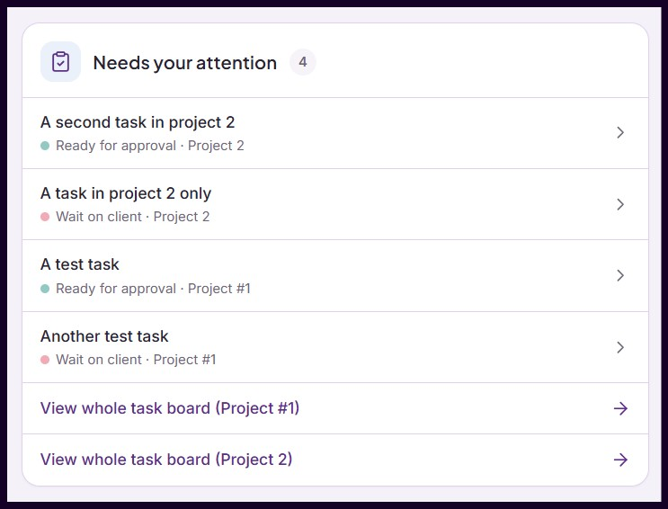
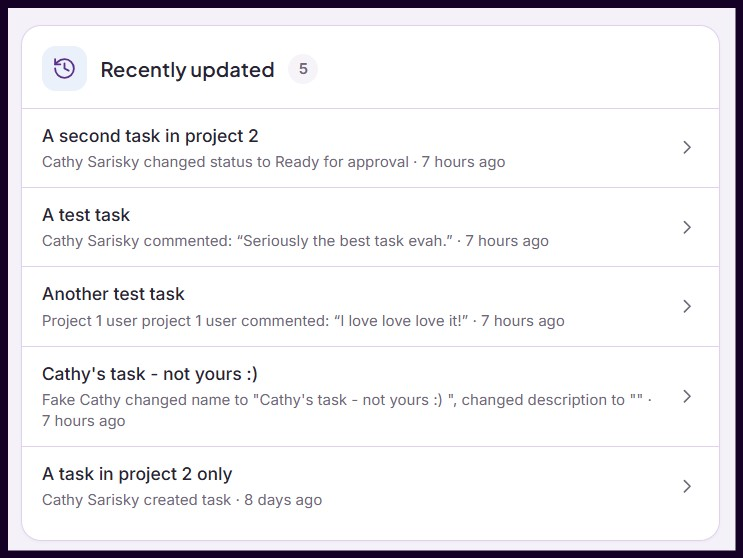
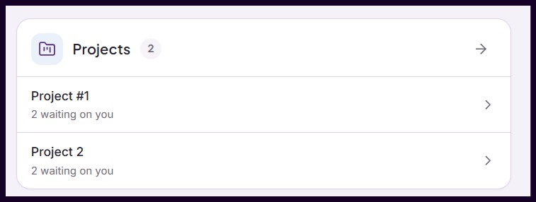

# Moxie portal snippets

Drop-in customisations for the [Moxie](https://www.withmoxie.com) client portal. One parent script does the plumbing; small snippets add the widgets and restyling you want on top. Everything is plain JavaScript pasted into Moxie's portal settings. There is nothing to install, no build step and nothing to host.

| Snippet | What it does |
|---|---|
| `logo` | Hides the workspace logo above the menu, or shows a different image in its place. |
| `custom-css` | Adds your own style rules, for every client or only for the clients you name. |
| `nav-tasks-link` | Adds a **Tasks** menu item that opens the client's task board for their first project. |
| `home-waiting` | Home card listing the tasks that are waiting on the client. |
| `home-recent` | Home card showing the latest comment or change on each task. |
| `home-requests` | Replaces the Home Requests card with every open ticket for the client. |
| `home-projects` | Replaces the Home "Projects" card with the client's actual projects. |



The Waiting on you card in a live portal. Its title was changed to "Needs your attention" by editing one line of the snippet.

## Requirements

- A Moxie workspace whose client portal settings include the **JavaScript embed code** box (Settings > Client Portal > Advanced).
- A way to look at the portal as a client: sign in as a portal contact, or use **Preview as contact** on a client's Portal access tab.

## How it works

The portal is a Vue 2 application. The parent reads its store and router through `#app.__vue__` and fetches data from the same internal endpoints the portal itself uses, under `/api/v1/{account}/portal/{client}/`, with the session's own token. In other words, we get the data your user has permissions to get anyway, and just display
it in a way that better suits our own businesses.

## Caution 

**None of this is a documented Moxie API**, so a portal update can rename an element, a component or an endpoint and break a snippet. The whole thing might just stop working. Don't use this approach for any changes that are mission-critical absolutely must run or else the clients are going to see something secret, because the day might come when it just ... doesn't.

Load the portal sparingly while testing. Moxie's sign-in service blocks an address that loads the portal roughly fifteen times in five minutes, for a couple of minutes, and that includes your own browser.

## Install

Everything happens in your browser: copy a file from this repository, paste it into Moxie.

1. In Moxie, open **Settings > Client Portal > Advanced** and find the **JavaScript embed code** box. Keep that tab open.
2. Open [core/moxie-portal.js](core/moxie-portal.js) on GitHub and click the **Copy raw file** button above the code (the two-squares icon), or select all of the text and copy it.
3. Paste it into the box. This is the parent script, and it must be the first thing in the box.
4. In the pasted text, find the settings near the top: `var CLIENT_FILTER`, `var WAITING_STATUSES` and `var HOME_CARDS`. Change them for your workspace; [Parent settings](#parent-settings) explains each. The defaults run for every client and show all four Home cards.
5. For each widget you want, open its file in the [snippets](snippets/) folder, copy it the same way, click at the very end of the box and paste it there. Snippets can go in any order, as long as every one of them is below the parent.
6. Save.
7. Check your work by viewing as a client.
If nothing shows up, the usual reason is `CLIENT_FILTER`: the client you are looking at does not match it.

### Changing or removing a snippet later

Each snippet's settings are the lines starting with `var` just under its banner comment, the one that reads `/* MoxiePortal snippet: ... */`. Edit them in the Moxie box and save.

To remove a snippet, delete its block: from its banner comment down to the line before the next banner, or to the end of the box. To update a snippet, delete the old block and paste the new file in its place.

## Parent settings

All three are near the top of the parent script, whether you edit it in the Moxie box or in the file.

**`CLIENT_FILTER`** decides which clients see any of the snippets. It maps client custom-field *mapping keys* to required values. A client passes when every entry matches; case and surrounding spaces are ignored. Each snippet can narrow this further with its own `ONLY_FOR` setting, described under [Snippets](#snippets).

```js
var CLIENT_FILTER = null;                                   // every client
var CLIENT_FILTER = { ClientType: 'Retainer' };             // one field
var CLIENT_FILTER = { ClientType: 'Retainer', Tier: 'A' };  // several fields, all must match
```

The mapping key is the field's identifier in Moxie's client custom-field settings. It is the same name merge tags use, so a field you reference as `{{Client.Custom.ClientType}}` has the mapping key `ClientType`.

**`WAITING_STATUSES`** lists the task status labels that mean "the client needs to act". The Waiting on you card shows those tasks and the Projects card counts them. Labels must match the status names in your project types, apart from case.

```js
var WAITING_STATUSES = ['Wait on client', 'Ready for approval'];
```

**`HOME_CARDS`** arranges the Home cards. Each inner list is one row; the cards in it sit side by side and share the row's width (on a phone they stack). A name on its own, outside any inner list, gets a row to itself. Order in the list is order on the page.

```js
var HOME_CARDS = [
  ['waiting', 'recent'],      // first row: two cards side by side
  ['requests', 'projects']    // second row
];

var HOME_CARDS = ['waiting', ['requests', 'projects']];   // Waiting full width, then a pair

var HOME_CARDS = [['requests']];                          // only Requests, even if other snippets are pasted
```

The names are `waiting`, `recent`, `requests` and `projects`. Remove a name and that card is not shown even if its snippet is pasted. A pasted card whose name is missing from the list is still shown, after the listed ones, in a row of its own, so forgetting to update the list never hides anything by accident.

## Snippets

Each snippet has its editable text and settings at the top of its file. Every one of them also has:

| Setting | Default | Meaning |
|---|---|---|
| `ONLY_FOR` | `null` | Run this snippet only for clients whose custom fields match, e.g. `{ ClientType: 'TNC' }`. It works like `CLIENT_FILTER` and applies on top of it. `null` means every client the parent allows |

**Different looks for different clients.** Paste a snippet twice with different settings and different `ONLY_FOR` values, for example one `custom-css` block with a green menu for `{ ClientType: 'TNC' }` and another with a blue menu for `{ ClientType: 'Agency' }`. Only the copy whose filter matches the signed-in client runs. This works for every snippet, including the Home cards, as long as the two filters do not overlap.

### logo

Hides the workspace logo above the left menu, or shows a different image in its place, with optional sizing. The portal switches to a separate small image while the menu is collapsed, and that one has its own setting.

**Note: Logo swapping can lead to a noticeable flash of the original logo. Use with caution **

| Setting | Default | Meaning |
|---|---|---|
| `LOGO_CHANGE` | `'none'` | Logo while the menu is expanded. `'none'` hides it; a URL such as `'https://example.com/logo.png'` shows that image instead; `''` leaves the workspace logo alone |
| `LOGO_COLLAPSED` | `null` | Small logo while the menu is collapsed. `null` does the same as `LOGO_CHANGE`; `'none'` hides it; a URL shows that image, for example a square icon; `''` leaves the portal's own small image alone |
| `LOGO_WIDTH` | `''` | Expanded logo width, e.g. `160` (pixels) or `'80%'`; `''` keeps the portal's sizing |
| `LOGO_HEIGHT` | `''` | Expanded logo height, e.g. `48` (pixels); `''` keeps the portal's sizing. Sizes apply to a replacement logo or to the original one, and the image keeps its proportions when only one side is given |

### custom-css

**Note: Large scale recoloring can lead to a noticeable change from old to new style. Use with caution ** 

Adds your own style rules to the portal. Because of `ONLY_FOR`, this is how you give one group of clients a different look: a menu colour, a hidden element, a different font.

| Setting | Default | Meaning |
|---|---|---|
| `CSS` | two lines that colour the left menu green | One rule per line. Each line sits inside single quotes and ends with a comma, so use double quotes inside a rule, as in `url("https://...")` |

The default lines recolour the left menu, by changing the variable its background comes from, and the marker beside the selected menu item:

```js
var CSS = [
  '#app { --v-sidebar-base: #1B5E20 !important; }',
  '#left-nav .portal-nav-link.is-active::before { border-left-color: #A5D6A7 !important; }'
];
```

**Changing the portal's colour variables.** The first default line is the pattern: the portal reads most of its colours from CSS variables, and one rule that sets a variable recolours everything that uses it. The brand colour behind buttons, focus rings and selected choices, for example:

```js
var CSS = [
  '#app { --brand-primary: #1B5E20 !important; }'
];
```

Use `#app` as the selector and keep the `!important`: the portal writes its variables as an inline style on that container, and only an important declaration in a stylesheet, on that same element, wins over them. The variables the portal exposes, with example values and what each affects, are listed in [docs/css-variables.md](docs/css-variables.md).

### nav-tasks-link

Adds a **Tasks** item right after **Projects** in the left menu. It opens the task board of the client's first active project, follows the menu's collapsed mode, and is highlighted while the board is showing, with the Projects item un-highlighted at the same time. Nothing is added when the client has no active project.  If you use multiple projects with each client, this is probably not for you!

| Setting | Default | Meaning |
|---|---|---|
| `TASKS_LABEL` | `'Tasks'` | Menu text and tooltip |

### home-waiting

Lists tasks whose status is in `WAITING_STATUSES`, soonest due first, each with its status colour, project and due date. Clicking a task opens the task side panel, and the cards refresh when it closes. A footer links to each project's task board. Hidden when projects are turned off for the client.

| Setting | Default |
|---|---|
| `TITLE` | `'Waiting on you'` |
| `EMPTY` | `'Nothing is waiting on you right now.'` |
| `BOARD_LINK` | `'View whole task board'` |

Pictured at the top of this page.

### home-recent

For each task, the newest public comment or change made by someone other than the viewer within the last `DAYS` days, newest first. Clicking opens the task side panel.

| Setting | Default |
|---|---|
| `TITLE` | `'Recently updated'` |
| `DAYS` | `14` |
| `EMPTY` | `'No updates in the last 14 days.'` |
| `MAX_ROWS` | `5` |



### home-requests

Every open ticket for the client, most recently updated first, and hides Moxie's own Requests card, which lists only tickets the viewer filed, is assigned to or is copied on. Each row shows the ticket number, its status with the status colour, "New reply" when there is an unread reply, and when it was last updated. The arrow in the header opens the Requests page. Hidden when tickets are turned off for the client.

| Setting | Default |
|---|---|
| `TITLE` | `'Requests'` |
| `EMPTY` | `'No open requests.'` |
| `MAX_ROWS` | `5` |

### home-projects

The client's active projects in alphabetical order, hiding Moxie's own "Projects" card, which actually lists tasks awaiting approval. Each row shows the lifecycle when it is not Active, the due date, and how many tasks are waiting on the client. Clicking opens the project, on its task board when the client can see tasks. Hidden when the client has no active project.

| Setting | Default |
|---|---|
| `TITLE` | `'Projects'` |
| `MAX_ROWS` | `5` |



**How Home cards are placed.** The cards form a block above Moxie's own dashboard, in the rows set by `HOME_CARDS`. Moxie's dashboard stays below with whatever else it holds, minus the built-in cards that Requests and Projects stand in for. A card appears only once its data has loaded, so nothing shows half-filled, and the cards are rendered again each time the viewer arrives on Home.

## Buy me a tea?
Thank for trying out these client portal widgets.  Feedback welcome!  
[Want more cards?](https://www.spectralwebservices.com/tipjar/)

# More technical bits (it's ok to stop reading now)

## Writing your own snippet

A snippet is a self-contained function registered with `MoxiePortal.ready`. It runs when the viewer's client passes `CLIENT_FILTER` and the snippet's own `onlyFor` filter, if it gives one, and runs again whenever the viewer switches to another client that passes. Styles, hooks and Home cards registered during a run are removed automatically when that happens; return a function if there is anything else to undo.

```js
(function () {
  var GREETING = 'Welcome back';
  var ONLY_FOR = null;   // or { ClientType: 'TNC' }

  MoxiePortal.ready(function (portal) {
    portal.home.mount({
      name: 'hello',
      render: function () {
        var card = portal.card({ title: GREETING, icon: portal.icons.folder });
        card.appendChild(portal.empty('Signed in as ' + (portal.user().email || 'you')));
        return card;
      }
    });
  }, { onlyFor: ONLY_FOR });
})();
```

Register styles, hooks and cards while your function runs, or from a promise that resolves soon after. A registration that arrives after the viewer has already switched to a different client is dropped rather than carried over, so nothing from one client leaks into another.

The bundled files stick to ES5 (`var`, `function`) so they paste anywhere without a build step. Your own snippets can use whatever JavaScript your clients' browsers support. A snippet that throws is logged to the browser console as `[MoxiePortal] snippet failed` and does not stop the others.

### The `portal` object

**App access**

| Member | Meaning |
|---|---|
| `portal.store`, `portal.router` | The portal's Vuex store and Vue router |
| `portal.go(path)` | Navigate, e.g. `portal.go('/requests')` |
| `portal.clientId()` | The current client's id |
| `portal.clientValues()` | Client custom fields as `{ mappingKey: value }` |
| `portal.user()` | The signed-in contact: `id`, `firstName`, `lastName`, `email` |
| `portal.features()` | Portal feature flags such as `projectsEnabled` and `ticketsEnabled` |
| `portal.api(path)` | GET a portal API path for the current client, e.g. `portal.api('/projects')`. Resolves the JSON; rejects with `HTTP <status>` |

**Hooks** (removed automatically when the client changes)

| Member | Meaning |
|---|---|
| `portal.onRoute(fn)` | `fn(to, from)` after each navigation |
| `portal.onDom(fn)` | `fn()` at most once per frame after the page changes, including a class change such as the menu collapsing |

**Styling**

| Member | Meaning |
|---|---|
| `portal.style(css)` | Adds a stylesheet; removed automatically |

**Data** (cached per client; each returns a Promise)

| Member | Meaning |
|---|---|
| `portal.data.projects()` | All projects |
| `portal.data.projectTypes()` | Project types with their status lists |
| `portal.data.tasks()` | Tasks the viewer may see, as `{ task, project, status, statusList }` |
| `portal.data.waitingTasks()` | Tasks in a `WAITING_STATUSES` status, soonest due first |
| `portal.data.tickets()` | Open tickets, newest activity first |
| `portal.data.ticketSettings()` | Ticket types, including status colours |
| `portal.data.refresh()` | Forget cached data |

**Tasks**

| Member | Meaning |
|---|---|
| `portal.tasks.visible(project)` | Whether the portal shows this project's tasks |
| `portal.tasks.open(item)` | Open the side panel for a `tasks()` item; Home cards refresh when it closes |

**UI helpers**

| Member | Meaning |
|---|---|
| `portal.card({ title, icon, count, openPath })` | A card with a header; `openPath` adds an arrow button that navigates there |
| `portal.row(title, meta, dotColor, onClick)` | A clickable list row in the portal's own style |
| `portal.empty(text)` | Muted "nothing here" text |
| `portal.footer(text, onClick)` | Full-width link at the bottom of a card |
| `portal.el(tag, className, text)`, `portal.svg(paths, size)`, `portal.button(className, onClick)` | Element builders |
| `portal.icons` | Lucide icon paths: `tasks`, `folder`, `chevron`, `arrow`, `ticket`, `history`, `listChecks` |
| `portal.timeAgo(ms)`, `portal.formatDue(date)`, `portal.norm(s)` | Formatting helpers |

**Home cards**

| Member | Meaning |
|---|---|
| `portal.home.mount({ name, replaces, render })` | `name` is how `HOME_CARDS` refers to the card; the element gets the id `mp-<name>`. `replaces` optionally names a built-in Moxie card to hide while yours shows: `'Tickets'` or `'Deliverables'`. `render()` returns an element, a Promise of one, or `false` to hide the card. A card not named in `HOME_CARDS` is shown after the listed ones in a row of its own |
| `portal.home.refresh()` | Re-fetch data and render every mounted card again |

## Development

```sh
npm install
npm test        # syntax-checks every file, then runs the parent's jsdom tests
```

Tests cover the parent script. Snippets are checked by hand in the portal. To assemble everything into one file for your own pasting, concatenate in the right order: `cat core/moxie-portal.js snippets/*.js > portal.js`.

## License

MIT. Copyright (c) 2026 Cathy Sarisky, [Spectral Web Services](https://www.spectralwebservices.com).
